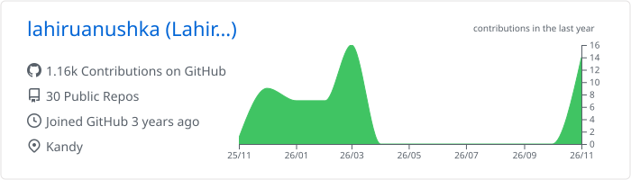
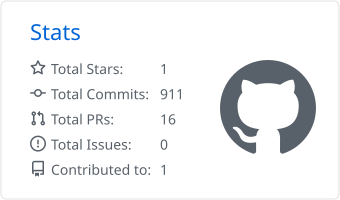
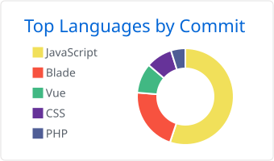

<div align="center">


<br/>

<a href="https://linkedin.com/in/lahiruanushka"></a>
<a href="https://lahiruanushka.netlify.app/"></a>
<a href="https://stackoverflow.com/users/22661832"></a>
<a href="https://dev.to/lahiruanushka"></a>
<a href="mailto:lahiruanushkaofficial@gmail.com"></a>

</div>

<br/>

### Hi, I'm Lahiru 👋

I'm a full-stack developer from Sri Lanka who likes owning the whole thing, from the database schema to the last button on the screen.

I work mostly with **Next.js, React and TypeScript** on the frontend and **C#, ASP.NET Core and SQL Server** on the backend. I care about the unglamorous parts: queries that stay fast, forms that make sense, and code the next developer can actually read.

```
📍 Kandy, Sri Lanka        💼 Associate Software Engineer
🎓 HNDIT, SLIATE (ATI Kandy)   🔭 Exploring AI features & scalable backends
```

<br/>

### 🛠 Stack

<picture>
  <source media="(prefers-color-scheme: dark)" srcset="https://skillicons.dev/icons?i=nextjs,react,ts,tailwind,cs,dotnet,nodejs,git,github,vscode,postman,figma&theme=dark">
  
</picture>


<sub>Also worked with: PHP · Laravel · Vue · Angular · Express · MySQL · MongoDB</sub>

<br/>

### 🚀 Featured projects

| Project                                                                   | What it is                                                                                          | Built with                                                     |
| ------------------------------------------------------------------------- | --------------------------------------------------------------------------------------------------- | -------------------------------------------------------------- |
| [**BlogVerse**](https://github.com/lahiruanushka/react-appwrite-blog-app) | A full blogging platform with auth, rich-text posts, bookmarks, user profiles, search and dark mode | React · Redux Toolkit · Appwrite · Tailwind · TinyMCE          |
| [**3D Portfolio**](https://github.com/lahiruanushka/react-portfolio)      | An interactive portfolio site with Three.js 3D scenes, animated timeline and a working contact form | React · Three.js · React Three Fiber · Framer Motion · EmailJS |

<br/>

### 📊 GitHub activity

<div align="center">

<picture>
  <source media="(prefers-color-scheme: dark)" srcset="./profile-summary-card-output/github_dark/0-profile-details.svg">
  
</picture>

<picture>
  <source media="(prefers-color-scheme: dark)" srcset="./profile-summary-card-output/github_dark/3-stats.svg">
  
</picture>
<picture>
  <source media="(prefers-color-scheme: dark)" srcset="./profile-summary-card-output/github_dark/2-most-commit-language.svg">
  
</picture>

<picture>
  <source media="(prefers-color-scheme: dark)" srcset="https://raw.githubusercontent.com/lahiruanushka/lahiruanushka/output/github-snake-dark.svg">
  
</picture>

</div>

<br/>

<div align="center">
<sub>Thanks for stopping by. Always happy to talk shop. Feel free to reach out.</sub>
</div>
